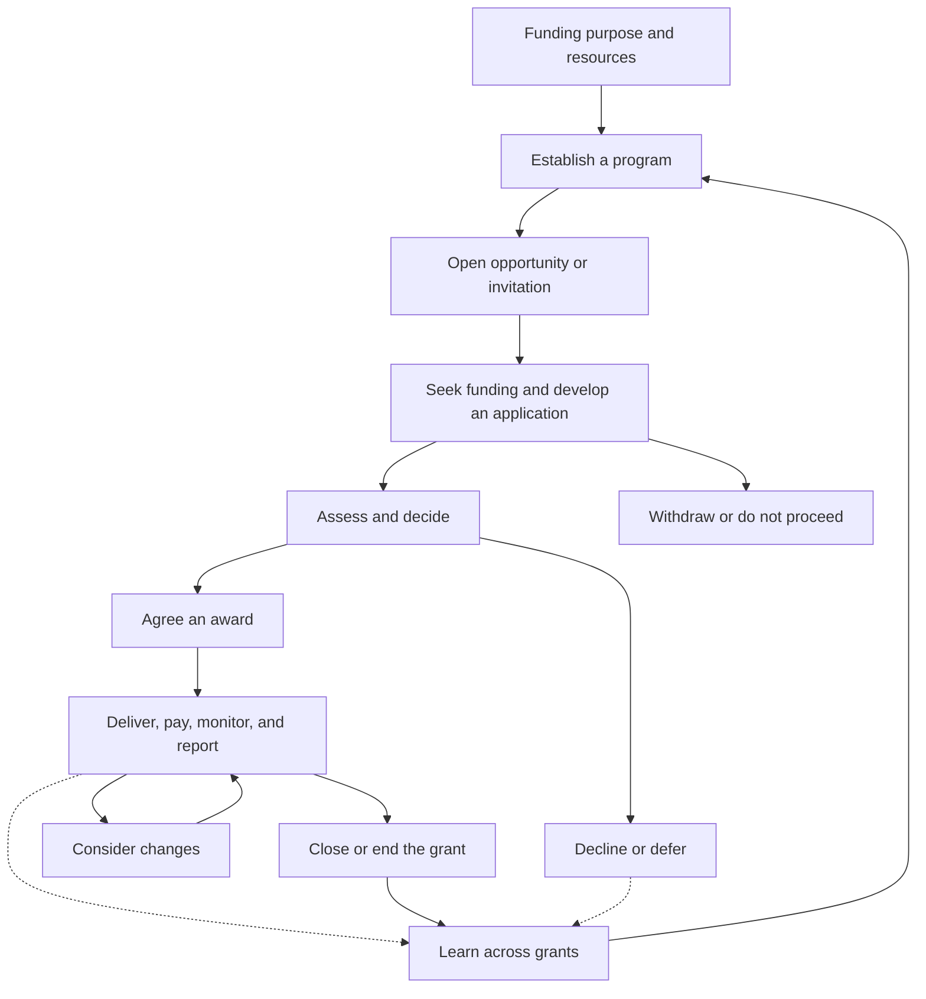

# The grant lifecycle

Grant management operates at three connected levels:

| View                  | What it follows                                                          |
| --------------------- | ------------------------------------------------------------------------ |
| Program               | A funding purpose, its resources, approach, and opportunities over time. |
| Application and award | A request, its outcome, and any resulting commitments and delivery.      |
| Portfolio             | Grants considered together to understand coverage, risk, and results.    |

This map combines the [Grants.gov pre-award, award, and post-award model](https://grants.gov/learn-grants/grants-101/the-grant-lifecycle)
with program design and learning across grants.

Paths vary: awards can support ongoing work, and new applications or renewals can
overlap existing grants. See [context](context.md). The map describes related work,
rather than a status sequence every grant must follow.

## Handoffs

- **Program to applicant:** purpose, eligibility, requested information, timing,
  and a route to support.
- **Applicant to assessment:** proposal, costs, evidence, and unresolved questions.
- **Assessment to decision:** judgments and recommendations, with decision authority
  identified separately.
- **Award to delivery:** agreed work, resources, conditions, contacts, and reporting
  expectations. See [selection and awards](journeys/select-and-award.md).
- **Delivery to closure and learning:** financial and delivery records, outstanding
  obligations, results, and reasons for changes.

The journeys follow these handoffs from each participant's perspective.
[Learning](journeys/learn-and-improve.md) can change active work as well as future
funding.
