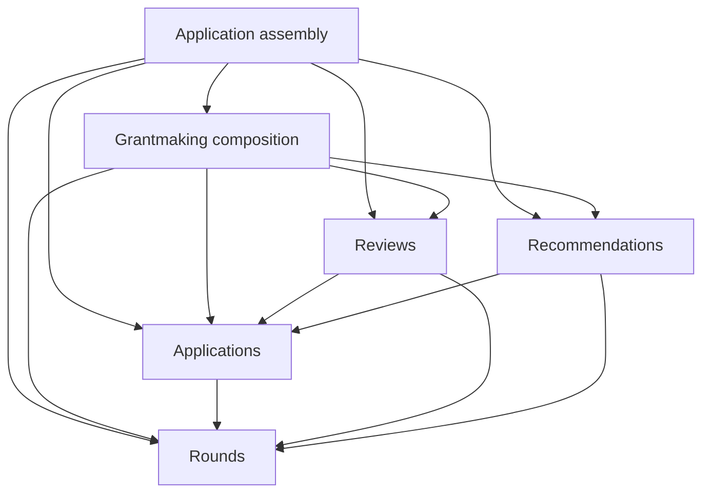
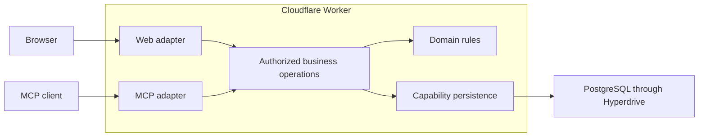

# Architecture

Merit's architecture preserves business meaning, authority, and dependable changes
across interfaces. It keeps the knowledge needed to perform an operation with the
capability that owns it, so callers can use that behavior without reconstructing
its rules. The [domain concepts](../domain/concepts.md) define the distinctions
those contracts must preserve.

The [design principles](#design-principles) guide changes across the application.
The [current system](#current-system) describes how Merit implements them today;
the [decision records](../decisions/README.md) explain technology choices, their
trade-offs, and reasons to reconsider them.

## Design principles

### Model grant work explicitly

**Use domain-driven design (DDD) to keep grant-work concepts, rules, and code aligned
as coding agents develop Merit.**

In this [portfolio and learning project](strategy.md#current-purpose-and-working-context),
a coherent model makes product and engineering decisions inspectable through the
demo and its implementation.

Start changes to business behavior from the [domain concepts](../domain/concepts.md)
and the relevant [workflow](../workflows/README.md). Identify the facts, judgments,
and commitments an operation changes, the conditions that must remain true, and
the capability that owns those rules. Carry these distinctions through names,
types, operations, web and MCP behavior, and tests. When the model needs to change,
revise its concepts, workflows, implementation, and examples together. Make the
scope of a term explicit where different contexts give it different meanings.

Ground new modeling choices in the researched domain material and the chosen
committee-preparation context. Where evidence leaves a consequential question
open, make a coherent product choice and record the assumption in the owning
concept or workflow. Keep that choice distinguishable from established grant
practice so later work can reconsider it.

Exercise the model with believable fictional scenarios: changed evidence,
conflicting assessments, unknown budgets, and revised recommendations. For example,
changing application material must preserve the original basis of an existing
assessment; saving a recommendation must retain its meaning as a proposal.
Use the relevant scenarios in tests and demo examples to expose contradictions
across operations and interfaces. These checks establish consistency with the
chosen model; suitability for actual grant work remains unvalidated by the demo.

Choose tactical DDD patterns when they clarify a demonstrated modeling problem or
serve an explicit learning objective. Evaluate them by the rules they make easier
to understand, enforce, and change, together with their ongoing cost. Build on the
existing pure domain functions and capability boundaries where they serve that
purpose.

### Design boundaries around behavior

**Choose a boundary around a coherent responsibility and the knowledge needed to
carry it out.**

Keep rules and changes that must remain consistent under an explicit owner. A
caller should be able to express the intended action without repeating
authorization, revision selection, transaction coordination, or recovery logic
that belongs to that owner.

An interface includes everything a caller must understand: inputs and outcomes,
permissions, preconditions, ordering, failure behavior, and relevant performance
limits. Make necessary obligations explicit and keep implementation choices
private. Separate responsibilities when they have different owners or reasons
to change; keep related behavior together when splitting it would spread its
coordination across callers. Shared code should preserve a shared meaning while
allowing distinct workflows to retain their own rules.

Judge a boundary by how much callers need to know, where a change must be made,
and whether its promised behavior can be verified through the contract. Neither
implementation size nor the number of layers establishes its quality. A larger
implementation can be justified when it contains complexity that would otherwise
be repeated or inconsistently handled.

For example, an editing controller owns the original revision baseline and exposes
workflow actions to its view. The view supplies edited values and presents outcomes;
the business operation independently checks current authority and revisions before
committing. Each interface hides its owner's coordination while retaining the
obligations its caller needs. The [web feature guide](../guides/web-features.md)
applies this principle to controllers, data adapters, and views.

### Platform and component responsibilities

**Use browser capabilities for document semantics, layout, sizing, scrolling, and
ordinary navigation. Shared controls own the interaction contracts callers rely on.**

Those contracts include focus, keyboard behavior, dismissal, and pending states.
Preserve them as implementations evolve, and keep routing and fetched-data
lifecycle with their existing owners.

Evaluate a platform feature or dependency change by its user benefit,
compatibility, accessibility, performance, and ongoing maintenance cost. Prefer
changes that simplify ownership or remove work while preserving the promised
behavior. Verify those outcomes at the affected boundaries before replacing an
established implementation. The [UI guide](../guides/ui.md#compose-and-style-a-feature)
applies these principles to shared components.

### Performance

**Design loading, navigation, interaction feedback, and collection rendering around
representative grant work and data volumes.**

Application assembly owns code loading and routing; capability web packages own
data needs and rendering work; business
capabilities own query cost. Keep the work required for the next useful screen or
interaction bounded, and account for growth when choosing data-loading and
rendering contracts. Shared infrastructure should support those owners without
duplicating their caches or lifecycle rules.

Set performance budgets from representative measurements and the experience the
workflow needs. Measure loading, local interaction response, and server completion
separately so an optimization addresses the actual delay. Retain before-and-after
evidence for consequential changes; the
[performance verification guide](../guides/verification.md#performance-verification)
defines what to record.

### Authority across interfaces

**Enforce authority and approval requirements in the owning capability, preserving
the same business meaning across interfaces.**

[Permission, delegation, and approval](../domain/concepts.md#authority-and-approval)
remain distinct. Merit checks the actor's current authority, the
client's granted scopes where applicable, and the operation's business
preconditions. External client conversations sit outside this verification
boundary; a granted scope or successful tool call does not establish that a
person individually reviewed its content.

Define who approves, what they approve, and how that approval is
established according to the action's consequences. Future publication and funding
decisions require those rules before implementation; their
[workflow design](../workflows/committee-decisions.md) remains separate from
current editable recommendations.

The [current access behavior](#data-and-access-boundaries) describes authentication,
delegated access, and edits that save directly today.

### Consistent changes and recovery

**Commit business changes and their audit records together, preserve the basis of
earlier judgments, and make failures recoverable without duplicating changes.**

Operations check current authority and caller-supplied revisions before committing.
Rejected operations roll back their
writes. Cross-capability writes follow the shared
[grant-work lock order](../../capabilities/organizations/business/src/server/persistence/commands/locks.ts),
so access revocation cannot race past an authorized save. Revision checks also
protect drafts when writes do not overlap in time.

Audit records preserve the actor, interface, and verified MCP client when present.
Unknown historical provenance stays unknown; attribution does not prove human
review or AI authorship. Preserve the distinction between the author of a judgment,
the person recording it, and any approval established by its workflow.

External effects have separate failure boundaries. Retries must neither duplicate
a change nor lose a committed result. Progress, limits, and recovery remain
visible to the person waiting.

Preserve source versions and attribution when evidence or judgments change.
Retention must explicitly cover source material, derived data, history, and backups.

### Stable web addresses

**Web addresses identify resources independently of display names.**

Renaming a round or application preserves its identity and links. Permission checks precede any
redirect that reveals the current title. Web addresses and published MCP identifiers
evolve independently.

## Current system

The current system is one TypeScript application with web and MCP interfaces over
shared business capabilities.

### Responsibilities and dependencies

| Location                        | Responsibility                                                                                                               |
| ------------------------------- | ---------------------------------------------------------------------------------------------------------------------------- |
| `app/`                          | Worker assembly, root document and router, account lifecycle, request context, external adapters, and runtime configuration. |
| `interfaces/`                   | Product, site, admin, MCP, and email presentation and protocol integration.                                                  |
| `capabilities/<name>/business/` | Domain rules, browser-safe contracts, authorized operations, transactions, and persistence.                                  |
| `capabilities/<name>/web/`      | Reusable views, editing controllers, drafts, query/cache behavior, translations, and public examples.                        |
| `capabilities/access/`          | Shared authorization policy.                                                                                                 |
| `foundation/`                   | Technical libraries and UI primitives, independent of business capabilities.                                                 |
| `tooling/`                      | Development, build, and verification infrastructure.                                                                         |

Dependencies flow from application to interfaces to capabilities to foundation.
Capability web packages use browser-safe business entries and deliberate public
integrations. Business packages never import web code. Capabilities never import
interfaces or application assembly, including through types or TypeScript source
inclusion. Foundation libraries remain independent of capabilities. Package
relationships stay acyclic; shared business behavior belongs to its capability.

Within a business package, domain rules evaluate explicit inputs without I/O or
mutation. Authorized operations supply current facts, apply rules, and own
transaction boundaries. Persistence keeps queries, locks, and writes private.
Public entries separate browser-safe definitions from server operations; narrow
schema and scope exports support cross-capability joins without transferring
ownership of writes.

Rounds, applications, reviews, recommendations, grantmaking, contacts, and organizations
make these roles explicit with `domain/`, `api/`, and `server/`.
Their browser-safe APIs define service interfaces independently of the server
implementations. Commands and queries have separate handlers and persistence;
command persistence includes the state reads needed for a consistent change.
Shared schema, locks, projections, and encoding cannot depend on either group.
Live storage and public payloads reuse pure capability encoders; API adapters retain
explicit public-field selection. Immutable stored-history encoding stays independent. The
[grantmaking guide](../../capabilities/grantmaking/business/extending-api.md),
[contacts guide](../../capabilities/contacts/business/README.md), and
[organizations guide](../../capabilities/organizations/business/README.md) map these roles.
The [architecture checks](../guides/architecture-checks.md) enforce the common
production roles and privileged integrations. API definitions share one pure role;
their internal organization and test placement remain design decisions.

Grant work has four state owners: Rounds owns configuration and criteria;
Applications owns intake, material, history recording, and creation receipts; Reviews owns assessments and participation;
Recommendations owns manager proposals and allocations. Grantmaking composes reading
views, history presentation, personal navigation, and examples. Its combined
application record is a read model, not a unit saved by one general-purpose command.

Arrows show package dependencies. Lifecycle collaborators supplied by assembly use
the caller's transaction and held locks: round deletion checks application usage,
and application deletion checks downstream work. Full intake history is composed
under the same case lock. These contracts preserve atomicity without reverse package
dependencies. The [grant-work ownership map](../../capabilities/grantmaking/business/README.md)
explains revisions, authority, and historical payloads.

Service factories bind infrastructure; each operation receives its actor
explicitly. Application assembly supplies services independently to browser and
MCP adapters. Adapters resolve identity, parse inputs, and translate typed
outcomes. Unexpected failures reach the interface boundary, which records a safe
diagnostic and reports unavailability without exposing confidential details.

Package exports define the supported consumer interface. Server imports between
capabilities also require an approved consumer role and public entry. Application
assembly connects service implementations and injected dependencies; ordinary
commands and queries cannot call another capability's demo or service assembly.
Organization read predicates and command locks have separate public entries.
Internal helpers stay private and use relative imports. Integration tests and
approved tooling may compose production code; runtime code stays independent of
them. Capability tests and stories have the
same prohibition on importing application or interface source.

### Application structure

The application keeps its Worker, Start, and router entry points in `app/src/`.
`shell/` owns the root document, account-session lifecycle, styles, and messages.
`server/` owns request identity, capability assembly, MCP authentication wiring,
demo orchestration, and external adapters. `development/` contains the local
identity fixtures and development tools, excluded from production builds.
Request context types remain browser-safe and depend on interface contracts.

The [service assembly](../../app/src/server/services.server.ts) connects capability
implementations to request identity and delivery dependencies. Browser identity
resolves lazily within Start's request context; MCP binds profile reads to its
verified bearer account. Each request owns its identity and profile cache.

Browser interfaces own routes, page assembly, typed navigation, and concrete
transport. Capability web packages own reusable interactions. Views present work,
controllers coordinate drafts and commands, and data adapters own queries and
cache effects. The [web feature guide](../guides/web-features.md) maps changes to
these layers and their tests.

Product, site, and admin contribute routes to one application router and Start
compilation. The application's TypeScript project includes those interfaces.
Capability web packages typecheck independently of generated application types.
[Development verification](../guides/verification.md#verification) checks both,
along with dependency direction, runtime restrictions, and ownership boundaries.

The public demo uses ordinary product screens and authorized operations in an
isolated database workspace. Public-guide examples instead use explicit fictional,
page-local state supplied by capability exports. The site owns their editorial
context. See [demo behavior](../workflows/public-demo-and-access.md) and
[public-guide authoring](../../interfaces/site/src/features/docs/README.md).

Organizations owns demo lifecycle and expiry. Application assembly coordinates
capability-owned seeding and removal: creating the workspace and its fictional
content commits together, and concurrent starts for one user serialize. Reset
creates new record identities without changing the account or other workspaces.

### Web platform

React Aria supplies interaction and accessibility behavior within shared controls;
Merit owns their presentation and composition. Router owns routing, and Query
owns fetched-data lifecycle.

#### Browser support

Merit targets current stable Chrome, Edge, Firefox, and Safari on desktop, and
current stable Chrome and Firefox on Android and Safari on iOS. People should be
able to read evidence, navigate, edit, save, and recover work throughout this
supported set. Older releases, enterprise-pinned versions, and special
compatibility requirements for managed devices are outside the support commitment.
This keeps compatibility work focused on current browsers as the platform evolves.

Use [Baseline Widely available](https://web.dev/baseline) features as the default
starting point. Newer features can be adopted when verified across the supported
browsers or when an enhancement preserves a usable experience without them.
Define that experience before choosing a fallback. Add compatibility code only
where a supported browser needs it, and weigh its maintenance and loading cost
against a simpler design. Baseline informs feature selection; the current-release
policy above defines the browsers Merit supports. The
[verification guide](../guides/verification.md#browser-compatibility) describes verification.

### Runtime and request flow

The public website, product, operator administration, and MCP share one origin
and one Cloudflare Worker. [Application assembly](../../app/src/server.ts)
creates services per request and supplies identity and external-service adapters.
Browser and MCP transports call the same business operations.

TanStack Query owns fetched data and mutation state. Server caches are isolated
per request; browser caches belong to the account session. Account changes clear
private cached data and drafts. Cached records never grant access. Features own
refresh effects and preserve the distinction between a committed write and a
failed refresh; forms retain their original revision baselines separately from
fetched data. The [query guide](../../foundation/query/README.md) owns this lifecycle.

PostgreSQL holds capability-owned schemas in one database and migration history.
Hyperdrive pools connections with query caching disabled, so authorization and
reads after changes use current database state. [Deployment](../guides/deployment.md)
covers configuration; [development](../guides/development.md#schema-changes)
covers migrations. Shared [money](../../foundation/money/README.md) and
[calendar-date](../../foundation/dates/README.md) contracts preserve meaning across
storage and transports.

### Data and access boundaries

Clerk verifies account sessions and MCP OAuth tokens. Authentication maps verified
external subjects to internal Merit user IDs before business operations run.
Anonymous browser sessions use temporary Merit users resolved from hashed random
bearer cookies; the cookies contain no permission claims. A configured identity
provider failure never falls back to a guest. Signing in opens the account's own
demo rather than taking over anonymous progress.

Each organization is a tenant. Workspace access requires current membership, an
active account, and an available workspace, including for direct URLs, server
functions, and historical reads. Expired demos deny access. Demo visitors
have program-manager access without team administration; demo invitations are
rejected. Operator authority alone grants no workspace membership.

Reviewer assignments grant access to one application independently of workspace
membership. Every reviewer operation checks the current assignment and account;
acceptance opens the assigned evidence, revocation ends access, and a reported
conflict pauses it. The [reviewer workflow](../workflows/participate-in-review.md) owns
these rules and the privacy of drafts.

MCP requires verified OAuth identity, client ID, and scopes in every mode. Browser
cookies and local fixture identities never authorize MCP. Operations recheck
current database permissions in addition to the client's grants. Operations exposed
through both web and MCP preserve the same business rules, history, and recovery
guarantees. The [MCP guide](../guides/mcp.md) owns current availability, client
grants, and the published contract; the
[MCP development guide](../../interfaces/mcp/README.md) explains its adapters.

The [access capability](../../capabilities/access/README.md) evaluates shared
policy from current facts; missing facts deny access. Its in-memory and SQL
evaluators use the same rules. Capabilities supply facts and enforce outcomes,
while retaining ownership of transactions and validation. The access package
imports no capability schemas; its SQL evaluator stays server-only.

`foundation/auth` owns users and verified identity. Organizations owns tenants,
memberships, invitations, and their writes. Its narrow server-only schema and
scope exports let other capabilities check membership and coordinate grant work.
Contacts similarly exposes scoped profiles while retaining private history and
writes. The [grantmaking model](../../capabilities/grantmaking/business/README.md)
explains application records and coordination with contacts and organizations.

Auth resolves verified account subjects to an active internal user or a disabled
outcome; interfaces translate that outcome into their own responses. Clerk adapters
own provider verification and profile reads, with profile snapshots shared only
within a request. The MCP interface owns its published scopes and HTTP errors.
Demo assembly supplies fictional user details from the grantmaking example; auth
owns their persistence and keeps attribution-only users inactive.

Tenant material and deliberations are confidential. External clients and AI
providers sit outside the trust boundary. Validate their inputs and outputs,
limit confidential content in diagnostics, and make external sharing subject to
organization policy. Published contracts must account for independently updated
clients; undeployed contracts can change with their adapters, tests, and docs.

Current requested, authorized edits save through web or MCP without an additional
browser approval step. A proposal awaiting acceptance is distinct from a request
to execute an edit. The [experience principles](experience.md#make-authority-and-commitment-clear)
explain how to make that distinction apparent, and the
[MCP guide](../guides/mcp.md) defines the current client contract.

### Audit, delivery, and retention

The [audit capability](../../capabilities/audit/business/README.md) records compact
workspace events, beginning with recommendation saves. Its trusted recording entry
uses the owning command's transaction; detailed evidence and judgment versions stay
with their business capability. Audit retains the actor's name with the recorded
action. A shared reading interface is deferred until a consuming workflow is
implemented. Shared events cover integrated actions
from deployment onward; existing histories remain authoritative for earlier work.

Invitations commit before email delivery so sending failures leave recoverable
work; the [email guide](../guides/emails.md#ownership-and-delivery) defines that
integration.

Demo deletion is a deliberate exception to retention for disposable data: lifecycle
operations verify workspace kind and expiry before cleanup. See the
[demo operating procedure](../guides/deployment.md#operate-demo-workspaces).

### Resource addresses and workspace discovery

The
[routing implementation](../../interfaces/product/src/features/grantmaking/page-routing.ts)
owns construction and canonical redirects.

Workspace discovery uses current memberships and returns permitted destinations:
funding rounds for grant work, Team for other members, and a chooser for multiple
workspaces. Reviewers can reach My reviews without workspace membership. An empty
workspace remains usable independently of funding rounds. The
[team workflow](../workflows/manage-team.md) and
[reviewer workflow](../workflows/participate-in-review.md) own these access rules.
