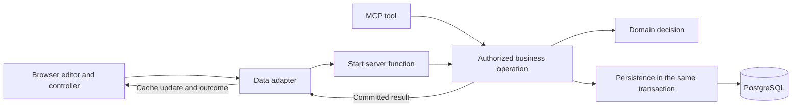

# Trace a recommendation save

Follow this path to understand how a browser edit reaches Merit's business core
and returns as saved work. The same operation serves MCP. The
[recommendation workflow](../workflows/recommend-funding.md) owns the business
rules; [web features](web-features.md) explains how to choose a layer when changing
the implementation.

After [local setup](development.md#protected-workspace), open an application and
edit its manager recommendation. Suppose its material is version 2 and its
recommendation revision is 3. Saving a €22,000 proposal must check both values,
record the actor and history, and return the committed recommendation and totals.
It remains a proposal, including when the round's proposed total exceeds its budget.

## Open the editor and retain its baseline

[ApplicationWork](../../interfaces/product/src/features/grantmaking/application-work.tsx)
composes the application reading view with `ApplicationRecommendation`.
Its [data hook](../../interfaces/product/src/features/grantmaking/data/workspace-data.ts)
reads the application through Query, decodes the result, and binds the save
mutation. The capability receives records and operations rather than importing
the product's routes or server functions.

The [recommendation editor](../../capabilities/recommendations/web/src/views/recommendations/recommendation-editor.tsx)
owns the form, localized feedback, budget preview, and focus restoration.
[useRecommendation](../../capabilities/recommendations/web/src/controllers/recommendations/use-recommendation.ts)
supplies its save action and draft updates. When a draft starts, the
[draft store](../../capabilities/recommendations/web/src/controllers/recommendations/recommendation-drafts.tsx)
retains the recommendation revision and application material version alongside
the editable values. Later typing and fetched-data updates preserve that original
baseline. See [draft integration](../../capabilities/grantmaking/web/README.md#scope-drafts-and-examples)
for its account lifetime.

The form checks input and converts the entered amount into exact money. Its
preview uses the domain's `previewRecommendation` with the draft allocation and
saved round context. This gives immediate feedback; the server still checks
current facts when saving.

## Carry the command across the browser boundary

The [product data binding](../../interfaces/product/src/features/grantmaking/data/recommendations/workspace-data.ts)
supplies application query options, the workspace's round-cache scope, and the
Start transport to the capability's
[recommendation adapter](../../capabilities/recommendations/web/src/data/recommendations/workspace-data.ts).
That adapter encodes the money and submits the workspace slug, application ID,
recommendation, and original baseline. In the example, `expectedRevision` is 3
and `expectedApplicationVersion` is 2 even if a background read has found newer work.

The [Start server function](../../interfaces/product/src/features/grantmaking/data/server/recommendations/recommendations.functions.ts)
validates the request, resolves the browser actor through `withActor`, and calls
`context.workspace.saveRecommendation`. It marks responses private and uncached
and encodes the result for transport. It does not decide grant eligibility or
construct audit records.

[Application assembly](../../app/src/server/services.server.ts) creates the shared
composed grantmaking service. The [Recommendations service factory](../../capabilities/recommendations/business/src/server/service.ts)
binds database access and the injected audit recorder to `saveFundingRecommendation`,
with the actor supplied explicitly on each call. Recommendations owns the recording
contract; application assembly supplies audit's implementation.

## Decide and commit in one transaction

[saveFundingRecommendation](../../capabilities/recommendations/business/src/server/commands/recommendations.ts)
owns the transaction and coordinates these steps:

1. Acquire the [case and access locks](../../capabilities/applications/business/src/server/persistence/locks.ts)
   and check current workspace availability, active membership, and grant access.
   Knowing the ID or having loaded the page earlier grants no authority.
2. Load current recommendation and financial facts through
   [command persistence](../../capabilities/recommendations/business/src/server/persistence/commands/recommendations.ts).
   Reject mismatched recommendation revisions or application material versions
   with `conflict` before writing.
3. Ask [prepareRecommendation](../../capabilities/recommendations/business/src/domain/recommendation.ts)
   to validate the proposal and calculate totals from those facts. This pure rule
   checks readiness for funding, preserves exact amounts, and records the current
   material basis. It performs no authentication or database work.
4. Assign authorship and provenance from the verified actor. Persistence advances
   the recommendation revision and appends its version with the actor and provenance
   in the same transaction. Earlier recommendation versions remain available as
   history; failure to record the new version rolls back the change.
5. Append the compact shared audit event through the injected recorder, using the
   same transaction. The event captures current identity, interface provenance,
   and the saved recommendation revision. Recording failure rolls back both the
   recommendation and its histories.

On success, the example returns recommendation revision 4, the saved recommendation,
the current round budget, and committed proposed and remaining totals. Authorship
supplied by a client cannot replace the actor established by Merit.

## Present the result without losing the draft or repeating a write

The return path deliberately distinguishes these outcomes:

| Outcome                      | Browser behavior                                                                                                                                                                                                                                        |
| ---------------------------- | ------------------------------------------------------------------------------------------------------------------------------------------------------------------------------------------------------------------------------------------------------- |
| `ok`                         | Cancel competing application reads, update the cached recommendation, revision, budget, and totals from the response, and invalidate workspace round reads without immediately refetching them. Confirm success, close the editor, and clear its draft. |
| `conflict`                   | Try to fetch the current application, retain the draft and its original baseline, and show the conflict. A failed fetch preserves the known conflict. The person discards the stale draft and starts again after reviewing current work.                |
| Validation or access failure | Present the typed failure without treating it as a save. Confirmed access denial in a subsequent read replaces previously authorized content.                                                                                                           |
| Thrown transport failure     | The controller returns `unavailable` and retains the draft. This is not confirmation that the server committed or rejected the write.                                                                                                                   |

A successful save needs no follow-up application fetch: its response supplies
the committed values. Later read failures follow the
[query recovery contract](../../foundation/query/README.md#mutation-and-failure-handling).
Retrying a read must not submit the recommendation again. This differs from
workflows that explicitly refresh after a save; their
[refresh integration](../../capabilities/grantmaking/web/README.md#recover-after-a-command)
preserves the same distinction between commitment and refresh.

## Reach the same operation through MCP

The [save_recommendation tool](../../interfaces/mcp/src/features/grantmaking/recommendation-tools.ts)
maps `applicationId` to `publicId` and `expectedRecommendationRevision` to
`expectedRevision`. It passes `expectedApplicationVersion` and the verified MCP
actor to the same service operation. The
[registrar](../../interfaces/mcp/src/components/register-tool.ts) enforces the
declared `grants:write` scope, validates responses, and reports unexpected failures
as unavailable. Business access and revision checks still happen in the operation.

MCP has no browser draft store or Query cache. The client retains its original
preconditions, reconciles conflicts, and reads current state after a lost response.
The [MCP guide](mcp.md#edit-and-recover) owns that recovery contract and monetary
formats. Both interfaces preserve the same business result and actor provenance.

## Change and verify the owning boundary

Use these tests to understand what each boundary establishes:

| Boundary                     | Evidence                                                                                                                                                                                                                                                                                                                                                 |
| ---------------------------- | -------------------------------------------------------------------------------------------------------------------------------------------------------------------------------------------------------------------------------------------------------------------------------------------------------------------------------------------------------- |
| Business decision            | [Domain tests](../../capabilities/recommendations/business/src/domain/recommendation.test.ts) cover validation, readiness, exact replacement totals, deferrals releasing a saved allocation, and unknown budgets.                                                                                                                                        |
| Database commitment          | [Integration tests](../../capabilities/grantmaking/business/tests/recommendations.integration.ts) cover restricted runtime privileges, stale and concurrent saves, revoked access, and rollback when history recording fails.                                                                                                                            |
| Draft and form               | [Controller tests](../../capabilities/recommendations/web/src/controllers/recommendations/use-recommendation.test.tsx) cover retryable failures and confirmed success; [editor tests](../../capabilities/recommendations/web/src/views/recommendations/recommendation-editor.test.tsx) cover input, preview, pending state, and focus.                   |
| Browser data and composition | [Adapter tests](../../interfaces/product/src/features/grantmaking/data/recommendations/workspace-data.test.ts) cover cache scope and conflict refresh failure; [route tests](../../interfaces/product/src/features/grantmaking/views/applications/application-route.test.tsx) cover connected saves, navigation, retained baselines, and access changes. |
| MCP integration              | The [persisted MCP journey](../../app/tests/mcp-workflow.integration.ts) verifies shared web state, safe retries, and verified provenance through real operations.                                                                                                                                                                                       |

For example, a changed funding-validation rule belongs in the business package;
update its domain cases and any affected form expectations. A round-preview check
passes one rejected recommendation through and confirms the round stays unchanged.
Run the owning
business suite with its coverage requirement and the affected web tests. Changes
to locks, persistence, or transport also need the corresponding integration checks.
[UI verification](ui-verification.md#verification) maps component ownership to
commands; [verification](verification.md) covers database setup and check selection.
Choose checks for the actual change rather than running every suite listed here.

[All practical guides](README.md)
