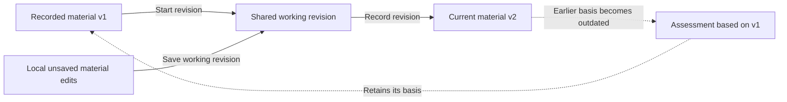

# Record and revise applications

Program managers record material received outside Merit, preserve its history,
and prepare it for assessment. This workflow is available through web and MCP,
including in the demo. It does not provide applicant sign-in or submission.

## Understand what is saved

An application can have current material, a shared working revision, and local
unsaved edits at the same time. Saving has a different effect depending on which
of these the person is editing:

| State                           | Who can see it                                                                                             | What changes it                                                                                      | Effect on current material and judgments                                                                                                                          |
| ------------------------------- | ---------------------------------------------------------------------------------------------------------- | ---------------------------------------------------------------------------------------------------- | ----------------------------------------------------------------------------------------------------------------------------------------------------------------- |
| Local unsaved edits             | The person editing in that browser tab.                                                                    | Typing changes the local draft; Save submits it, and Discard removes it.                             | None until saved. Local recovery follows the shared editing pattern.                                                                                              |
| Saved preparation               | Current workspace program managers, through web and MCP.                                                   | Saving application material while **In preparation**.                                                | Changed material becomes current immediately, with a new material version; earlier judgments can become outdated.                                                 |
| Shared working revision         | Current workspace program managers can inspect and edit it; ordinary reading still shows current material. | **Start revised submission** or **Correct intake** creates it; **Save working revision** updates it. | Saving its material leaves current evidence and judgment freshness unchanged. **Record revision** makes it current; discarding it leaves current material intact. |
| Current and historical material | Current workspace program managers, including through history reads.                                       | Preparation saves or **Record revision** establish a new current material version.                   | Earlier material remains identifiable. Assessments and recommendations retain their recorded bases until explicitly reconsidered.                                 |

For a ready application, recording a revision makes v2 current while retaining
v1 as history:

Starting or saving a working revision does not make the assessment outdated;
recording changed material does. Contact assignment and staff summaries are case
information with their own history, outside the material being assessed. A contact
change saved alongside a working revision takes effect immediately.

**Readiness**, **review progress**, and **freshness** answer different questions:
is intake complete, is requested review work outstanding, and does a judgment
refer to its current evidence basis? Assessments track material and criteria;
manager recommendations track application material. A ready application can have an outstanding
request and an outdated assessment simultaneously. Marking it ready does not
complete reviews or update their bases.

Material versions identify evidence; edit revisions detect concurrent changes.
For example, a staff-summary edit advances the intake revision without changing
the material version. The [business model](../../capabilities/grantmaking/business/README.md#versions-and-attribution)
maps these independent counters and the bases that assessments and recommendations
retain. The sections below explain each action's prerequisites and recovery.

## Create an application

Program managers can discover applications across the workspace's funding rounds,
search by application or applicant, filter by round or work state, and open a
case directly. The overview keeps intake readiness, review progress and
freshness, and the manager recommendation distinct. Opening an application and
returning preserves the originating list's search, filters, and sort. This
overview uses the same current program-manager access as application pages.

A program manager records an application in a round. Only its project title is
required; applicant, requested amount, and submitted material can be added during
creation or later preparation. Creation saves these together as a persistent
**In preparation** record, with submitted material separate from staff summaries.
Retrying a creation request does not create a duplicate, even after deletion.
All current workspace program managers can contribute. Applicant accounts and
applicant-facing submission are outside this workflow.

An application identifies the party seeking funding independently of its optional
contact person and contact email. Neither field creates an account or grants access.
Merit records the acting user who creates or changes the record. The applicant
may never use Merit; staff can still carry out the complete workflow.

This is the funder's application case. Recording material received elsewhere does
not assert that the applicant submitted or approved it through Merit. Preserve
the distinction between the material received, the person recording it, and staff
interpretation. Preparing the case and marking it ready for review are staff
actions, separate from an applicant's act of submission.

## Edit application details and material

The [contact workflow](manage-contacts.md) uses shared workspace contacts,
independently of application records. The contact is editable in **Application details**,
alongside the recorded applicant information. In the details form, contact selection
stays local until Save commits it with the other edits. The standalone contact
picker commits immediately and offers revision-checked Undo. Editing a person’s shared details
happens in **Contacts**, with its scope explained in the editor. Historical
application records preserve the recorded details.

Preparation includes the title, applicant, contact, requested amount, project dates,
and submitted sections. Project dates accept flexible periods such as
“March–August 2027.” Saving or discarding one section leaves unfinished changes
in the others intact. Recorded content still follows the correction and revision
workflow. During a working revision, saving application details updates the contact
link immediately; applicant, amount, and project date changes become current only
when the revision is recorded.

Managers enter the applicant’s material in sections with headings or original
questions and response text. Sections can be completed in any order; one section
can contain the complete submission. Budget details can be included in the text.
File attachments, extraction, and a structured budget editor are not available.
An optional staff summary stays separate from submitted material and identifies
its author. It can be added or edited while the application is incomplete and does
not affect readiness. Contact and summary edits retain history without changing
the basis of assessments.

The requested amount may initially be **Not known**, distinct from a confirmed
€0. Amounts use EUR and accept at most two decimal places. Round totals sum known
requests and disclose the number of unknown amounts. The round’s available budget
is independent of these requests and may also be unset.

## Save preparation and mark it ready

Saving persists incomplete preparation for colleagues and later visits. Marking
ready and recording a revision are separate commitments; unsaved application
content must be saved or discarded before either action. Application names can be
changed during preparation. Editing a recorded title prepares a correction with
the entered name; the current title stays unchanged until the manager explains,
saves, and records that correction. Local unsaved writing follows the shared
[editing pattern](../../foundation/ui/src/patterns/editing/editing.mdx), while
saved preparation and working revisions are shared.
A conflicting save loads current values and requires reconciliation before saving
again: managers can use saved values or retain their changes while incorporating
untouched fields. Submitted sections are reconciled as a complete ordered list.
No action silently overwrites a colleague’s newer edits.

**Mark ready for review** requires a title, applicant, confirmed requested amount,
and at least one substantive section, with a heading and response for every section.
Readiness means the intake record is complete, not that eligibility is established
or funding is warranted. It does not assign reviews. A funding recommendation
requires readiness; an explained deferral is possible during preparation.
Existing deferrals, review requests, and assessments remain available during
preparation. Explain missing requirements before readiness can be established.

## Correct or revise an application

Once ready, **Start revised submission** or **Correct intake** creates one shared
working revision from the current application. **Save working revision** persists
preparation while readers continue to see the current recorded material.
Managers can inspect the saved working revision before recording it and consult
current material without losing unsaved work. The current version remains explicit.
Discarding the shared working revision requires confirmation and leaves the current
application intact; discarding local unsaved edits only clears that local draft.

**Record revision** requires complete material, a change, and an explanation. It
makes the saved working revision current and retains the earlier material. Versions
identify the material available for assessment, not the number of times an applicant
used Merit. Initial preparation edits also retain their versions and attribution.
Recording a staff correction does not establish applicant approval or replace the
fact of what was recorded earlier. Assessments keep the material version on which
they were based until their judgment is explicitly reconsidered.
Version history compares any available earlier and later versions, including a
range that spans several revisions. Recorded updates within that range retain their
actors, dates, sources, and explanations. Comparisons identify changed and
unchanged material. Viewing a comparison changes neither the current submission
nor a judgment's recorded basis.

Each submitted section retains its question identity through heading edits, response
changes, reordering, and working revisions. Adding or duplicating a section creates
a new identity, even when its heading matches another section. Comparisons pair
identified sections across versions and show both headings when renamed. Earlier
material without identities remains readable: unique heading matches are only a
text comparison, and duplicate or renamed headings cannot establish continuity.
Editing those sections establishes identities for subsequent saved versions; it
does not rewrite earlier snapshots.

History uses stored application snapshots. An unavailable earlier version stays
explicitly unavailable; a version number or a review mentioning earlier material
does not supply the missing submission. Seeded applications may have no earlier
intake snapshots. Application history retains all recorded intake activity,
including contact and staff-summary changes
within the same submission version, working-revision actions, and the original
before/after records with their attribution.

Corrections to requested amounts or submitted answers change the assessment basis,
just as an applicant’s revised submission does. Earlier reviews and manager
recommendations become outdated. Their content and proposed allocations remain
intact until explicitly reconsidered; saving a recommendation against the current
version reaffirms or changes it. Even minor answer corrections use this conservative
rule. Contact changes and staff-summary edits do not invalidate judgments.

## Delete unused preparation

A manager can delete an application only while it has never been marked ready and
has no review requests, assessments, or manager recommendation, including
assessments received without a request. Confirmation
explains the loss of preparation details. The server rechecks current state and retains the
audit history and creation receipt. Withdrawal, archiving, and moving applications
between rounds are not available.

## Read and write guarantees

Application reads expose current material, readiness, unknown amounts, and the
separate shared working revision. Every intake write checks current program-manager
access and the intake revision, and commits its audit record in the same transaction.
Recommendation saves also check the material version on which the judgment is based.

The [intake presentation guide](../../capabilities/applications/web/src/views/intake/README.md)
owns editor placement, control labels, and screen states. The public
[application guide](../../interfaces/site/src/features/docs/application-guide.tsx)
explains the steps for people doing this work.

Next: [request and record reviews](review-applications.md). See the
[grantmaking overview](review-and-decide.md) for access and shared guarantees.
